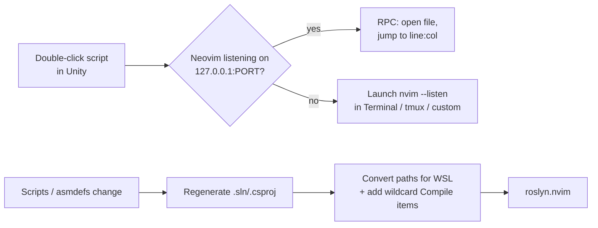

# Neovim Code Editor for Unity


Use **Neovim** as Unity's External Script Editor, either natively (Windows, macOS, Linux) or **running inside WSL**.

Double-click a script or a Console error and the file opens in your running Neovim at the right line and column. Unity keeps the `.sln` / `.csproj` files up to date, so Roslyn LSP (`roslyn.nvim`) has full IntelliSense for your project, including files you create from Neovim.

---

## Features

- **Real External Script Editor:** select *Neovim* or *Neovim (WSL)* in Preferences. No wrapper scripts.
- **Opens files in the running Neovim:** Unity talks to nvim over its RPC socket, so the file opens in the same instance at the exact line and column.
- **Launches Neovim when needed:** if Neovim isn't running, one is started in Windows Terminal, a tmux session, or a terminal command you choose.
- **One instance per project:** each Unity project gets its own Neovim on its own port.
- **Your shell environment:** in WSL, Neovim starts through your login shell, so `PATH`, `DOTNET_ROOT` and the rest of your `.zshrc` / `.bashrc` are set for Roslyn.
- **Project files stay current:** Unity's official generator (`com.unity.ide.visualstudio`) updates them whenever scripts, asmdefs or packages change.
- **WSL path conversion:** absolute Windows paths in the `.csproj` files (references, analyzers, `\\wsl$\…`) are rewritten to `/mnt/c/…`.
- **New files get LSP right away:** a wildcard `<Compile Include="…/**/*.cs"/>` is added for each assembly. It follows asmdef/asmref, `Editor` and `Plugins` folder rules, so files created outside Unity work before Unity recompiles.

## How it works



## Requirements

| | |
|---|---|
| Unity | 2021.3 or newer |
| Packages | `com.unity.ide.visualstudio` (installed automatically) |
| Neovim | 0.9+, native or inside WSL |
| LSP (optional) | .NET SDK + [roslyn.nvim](https://github.com/seblyng/roslyn.nvim), see [Roslyn setup](Documentation~/roslyn-setup.md) |

## Installation

**From git:** *Window → Package Manager → + → Add package from git URL…*

```
https://github.com/reaz1995/UnityNvimSupport.git
```

**From disk:** *Window → Package Manager → + → Add package from disk…* and select this repository's `package.json`.

> If you used the old loose scripts (`sln_csproj_generator.cs`, `csproj_references_for_wsl_fix.cs`), delete them from your project's `Assets/Editor`. Otherwise paths get converted twice.

## Quick start

1. Open *Edit → Preferences → External Tools*.
2. Set **External Script Editor** to:
   - **Neovim (WSL):** Neovim inside WSL.
   - **Neovim:** native `nvim` / `nvim.exe`, found on `PATH` or via Scoop, winget, Chocolatey, Homebrew and others. If it isn't listed, use *Browse…*.
3. **WSL only:** set **WSL distribution** to the distro where Neovim is installed (for example `Ubuntu`). The default distro is not always the right one; check with `wsl -l -v`.
4. Click **Regenerate project files**.
5. Double-click any script.

*Assets → Open C# Project* or *Tools → Neovim → Open Project in Neovim* opens Neovim in the project root.

## Launch modes

These control how a *new* Neovim is started. Once one is running, files always go to it.

| Mode | Behaviour |
|---|---|
| **Terminal** | **Windows:** a tab named `nvim - <Project>` in a Windows Terminal window called `nvim-unity`, or a console window if Windows Terminal isn't installed.<br/>**macOS:** Terminal.app.<br/>**Linux:** `$TERMINAL`, `x-terminal-emulator`, kitty, wezterm, alacritty, gnome-terminal, konsole or xterm, whichever is found first. |
| **Tmux** | A window named `nvim` in the configured session. The session is created detached if it doesn't exist (`tmux attach -t unity`). WSL / macOS / Linux. |
| **Custom** | Any command, with the placeholders `{nvimCommand}`, `{file}`, `{line}`, `{column}`, `{project}`, `{listen}`. |

Custom examples:

```sh
wezterm start --cwd "{project}" -- {nvimCommand}
alacritty -e {nvimCommand}
```

### Connecting your own Neovim

Any Neovim that listens on the project's port receives files from Unity. Preferences shows the port:

```sh
nvim --listen 127.0.0.1:<port>
```

## Settings

All settings are under *Preferences → External Tools* while Neovim is selected. They are saved per user.

| Setting | Default | Description |
|---|---|---|
| Launch new Neovim in | Terminal | See [Launch modes](#launch-modes) |
| Focus Windows Terminal | on | Bring the Neovim window to the front when a file is opened |
| RPC port | auto | `0` derives a stable port from the project path |
| Extra nvim arguments | – | Added to the launch command, e.g. `-c "Neotree show"` |
| nvim command | `nvim` | Executable used by the WSL / tmux launch script |
| WSL distribution | default | Distro that has Neovim installed |
| WSL mount root | `/mnt/` | Must match `[automount] root` in `/etc/wsl.conf` |
| Convert .csproj paths to WSL | on | Rewrites `C:\…` to `/mnt/c/…` |
| Add wildcard Compile items | on | New `.cs` files get LSP support immediately |
| Regenerate after every domain reload | off | Full regeneration after each reload; normally updates are incremental |
| SDK-style projects | off | Use the SDK-style generator of the Visual Studio package |
| Generate .csproj files for | – | Package filters: embedded, local, registry, git, … |
| Verbose logging | off | Log every launch / RPC call to the Console |

## Troubleshooting

<details>
<summary><b>"nvim was not found" in the terminal</b></summary>

The launch script ran in a WSL distro without Neovim, or `nvim` isn't on your login shell's `PATH`. Set **WSL distribution** (for example `Ubuntu`), or set **nvim command** to the full path (`which nvim` inside WSL).
</details>

<details>
<summary><b>A new Neovim opens every time</b></summary>

Unity can't reach the RPC port. Turn on *Verbose logging* and check:
- In WSL, `localhostForwarding` must not be disabled in `%UserProfile%\.wslconfig`.
- The port may be reserved by Hyper-V. Check with `netsh interface ipv4 show excludedportrange protocol=tcp` and choose another port.
</details>

<details>
<summary><b>Neovim starts tmux / does something odd on launch</b></summary>

Neovim is started with `$SHELL -lic`, which loads your `.zshrc` / `.bashrc`. If your shell rc auto-starts tmux, guard it, for example `[ -z "$TMUX" ] && [ -z "$NVIM" ] && …`.
</details>

<details>
<summary><b>LSP doesn't see new files or references</b></summary>

- Make sure *Add wildcard Compile items* is on, then click **Regenerate project files**.
- Make sure roslyn.nvim has file watching enabled (`filewatching = "roslyn"` or `"auto"`).
- In WSL, raise the inotify limits (see [Roslyn setup](Documentation~/roslyn-setup.md#4-file-watching-limits-linux--wsl)).
</details>

<details>
<summary><b>Project files still contain Windows paths</b></summary>

Path conversion only runs while **Neovim (WSL)** is selected. That way, switching back to Visual Studio or Rider gives normal project files. Select it, then regenerate.
</details>

## Security note

Neovim's RPC port listens on `127.0.0.1` only, but any process on your machine can connect to it. Avoid using this on shared machines you don't trust.

## Package layout

```
package.json
Editor/
  NvimCodeEditor.cs        External Script Editor registration (IExternalCodeEditor)
  NvimLauncher.cs          Open via RPC, or launch Terminal / tmux / custom
  NvimRpc.cs               Minimal msgpack-RPC client (nvim_exec_lua over TCP)
  ProjectFiles.cs          Drives the Visual Studio package's .sln/.csproj generator
  CsprojPostprocessor.cs   WSL path conversion + wildcard Compile items
  NvimPreferencesGUI.cs    Preferences UI
  NvimSettings.cs          EditorPrefs-backed settings
  PathUtility.cs, ProcessUtility.cs
Documentation~/
  roslyn-setup.md          .NET SDK, Roslyn LSP and roslyn.nvim setup
```

See [CHANGELOG.md](CHANGELOG.md) for release notes.
